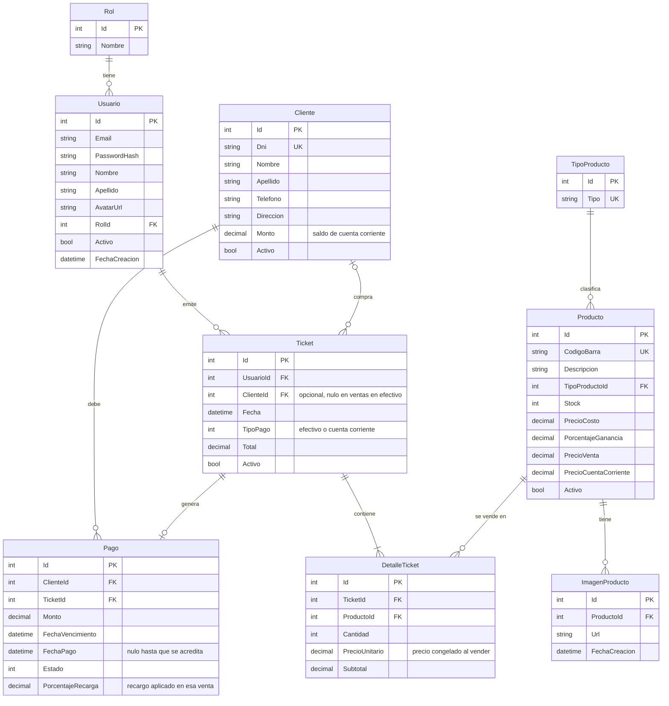

# Dulces Duendes

Sistema web para la gestión de la regalaría **Dulces Duendes**: productos con imagenes, control de stock, ventas por ticket y cuenta corriente de clientes.
Proyecto integrador final de **Laboratorio II**. Grupo 45: Urbani, José María y Ferrando, Carlos Enrique

## Problema que resuelve

Una regalería necesita atender rápido en el mostrador y, al mismo tiempo, saber qué tiene en stock, a qué precio venderlo y cuánto le debe cada cliente que compra "a cuenta". Hacerlo en papel o en planillas genera errores de precio, ventas de productos sin stock y deudas que se pierden.

El sistema permite:

- Registrar ventas rápidas por ticket, cargando productos por código de barras o buscándolos por descripción.
- Controlar el stock, con alertas de stock bajo y sin stock.
- Calcular automáticamente el precio de venta y el precio en cuenta corriente a partir del costo y del porcentaje de ganancia elegido para cada producto.
- Llevar el registro de clientes con cuenta corriente y de sus pagos pendientes.
- Administrar usuarios con roles (Administrador y Empleado).

## Tecnologías

- ASP.NET Core MVC (.NET 10) con Razor
- Entity Framework Core con Pomelo (MySQL)
- Vue 3 (build global, guardado en `wwwroot/lib/vue`, sin CDN ni Node)
- Bootstrap 5 y Bootstrap Icons
- Autenticación por cookie para el sitio y JWT (`Microsoft.AspNetCore.Authentication.JwtBearer`) para la API

## Cómo ejecutarlo

### Requisitos

- SDK de .NET 10
- MySQL en `localhost:3306` [COMPLETAR: versión probada]
- Herramienta de EF Core, solo si se usan las migraciones: `dotnet tool install --global dotnet-ef`

### Pasos

1. Clonar el repositorio y entrar a la carpeta del proyecto.
2. Revisar la cadena de conexión en `appsettings.json` (por defecto, usuario `root` sin contraseña y base `dulcesduendesdb`) y ajustarla si hace falta.
3. Crear la base de datos con **una** de estas opciones:
   - **Script SQL con datos de prueba:** importar `docs/sql/dulcesduendes.sql` [COMPLETAR: generar y subir el script].
   - **Migraciones:** `dotnet ef database update` (crea la base si no existe).
4. Ejecutar `dotnet run` y abrir `http://localhost:5003`.
   Al arrancar, el sistema crea los roles y los usuarios de prueba si no existen.

La clave de firma de los tokens JWT está en `appsettings.Development.json` y **es solo para desarrollo**. En un entorno real se define con la variable de entorno `Jwt__Clave` (mínimo 32 caracteres).

### Usuarios de prueba

| Rol           | Email                        | Contraseña     |
| ------------- | ---------------------------- | -------------- |
| Administrador | `admin@dulcesduendes.com`    | `Admin123!`    |
| Empleado      | `empleado@dulcesduendes.com` | `Empleado123!` |

## Modelo de datos

| Entidad          | Descripción                                                                                 |
| ---------------- | ------------------------------------------------------------------------------------------- |
| `Rol`            | Administrador o Empleado                                                                    |
| `Usuario`        | Cuenta de acceso, con rol y avatar                                                          |
| `TipoProducto`   | Categoría de producto                                                                       |
| `Producto`       | Código de barras, stock, costo, porcentaje de ganancia y precios derivados                  |
| `ImagenProducto` | Fotos de un producto (hasta 5)                                                              |
| `Cliente`        | Cliente con cuenta corriente                                                                |
| `Ticket`         | Venta, asociada al usuario que la emite y, opcionalmente, a un cliente                      |
| `DetalleTicket`  | Renglón de un ticket: producto, cantidad y precio unitario congelado al momento de la venta |
| `Pago`           | Pago pendiente de una cuenta corriente                                                      |



Relaciones principales:

- `Rol` 1:N `Usuario`
- `TipoProducto` 1:N `Producto`
- `Producto` 1:N `ImagenProducto`
- `Ticket` depende de `Usuario` y, de forma opcional, de `Cliente`
- `DetalleTicket` resuelve la relación N:M entre `Ticket` y `Producto`

## Matriz de evidencias de requerimientos mínimos

Los enlaces apuntan a la rama `main`.

| Requerimiento mínimo                                                                           | Estado      | Código                                                                                                                                                                                                                                          | Evidencia                                                                                                                                  |
| ---------------------------------------------------------------------------------------------- | ----------- | ----------------------------------------------------------------------------------------------------------------------------------------------------------------------------------------------------------------------------------------------- | ------------------------------------------------------------------------------------------------------------------------------------------ |
| 1. Modelo de datos con 6 o más tablas, relación 1:N y N:M (o entidad que dependa de otras dos) | ✅ Cumplido | [`ApplicationDbContext.cs`](Data/ApplicationDbContext.cs), [`Models/`](Models)                                                                                                                                                                  | [Diagrama ER](docs/der.png)                                                                                                                |
| 2. Login, logout, roles y avatar                                                               | ✅ Cumplido | [`AccountController.cs`](Controllers/AccountController.cs), [`UsuarioClaims.cs`](Common/Auth/UsuarioClaims.cs), [`PerfilController.cs`](Controllers/PerfilController.cs)                                                                        | [Perfil con avatar](docs/evidencias/perfil-avatar.png)                                                                                     |
| 3. Funcionalidad restringida por rol                                                           | ✅ Cumplido | [`UsuariosController.cs`](Controllers/UsuariosController.cs) (`[Authorize(Roles = ...)]`), [`AccessDenied.cshtml`](Views/Account/AccessDenied.cshtml)                                                                                           | [Empleado rechazado en /Usuarios](docs/evidencias/acceso-denegado.png)                                                                     |
| 4. Manejo de archivos adicional al avatar                                                      | ✅ Cumplido | [`AlmacenArchivos.cs`](Services/Implementations/AlmacenArchivos.cs), [`ImagenProductoService.cs`](Services/Implementations/ImagenProductoService.cs), [`ImagenesProductoAjaxController.cs`](Controllers/Ajax/ImagenesProductoAjaxController.cs) | [Galería de imágenes](docs/evidencias/imagenes-galeria.png)                                                                                |
| 5. ABM completo con Vue y AJAX                                                                 | ✅ Cumplido | [`productos.js`](wwwroot/js/productos.js), [`Productos/Index.cshtml`](Views/Productos/Index.cshtml), [`ProductosAjaxController.cs`](Controllers/Ajax/ProductosAjaxController.cs)                                                                | [ABM de productos (GIF)](docs/evidencias/abm-productos.gif)                                                                                |
| 6. Paginado por servidor                                                                       | ✅ Cumplido | [`PageRequest.cs`](Common/Pagination/PageRequest.cs), [`PagedResult.cs`](Common/Pagination/PagedResult.cs), [`ProductoRepository.cs`](Repositories/Implementations/ProductoRepository.cs)                                                       | [Petición con `page=2`](docs/evidencias/paginado-network.png)                                                                              |
| 7. Búsqueda asíncrona de entidades relacionadas                                                | ✅ Cumplido | [`selector-tipo.js`](wwwroot/js/componentes/selector-tipo.js), [`TiposProductoAjaxController.cs`](Controllers/Ajax/TiposProductoAjaxController.cs)                                                                                              | [Selector de tipo (GIF)](docs/evidencias/busqueda-asincrona.gif)                                                                           |
| 8. Web API REST con JWT                                                                        | ✅ Cumplido | [`AuthApiController.cs`](Controllers/Api/AuthApiController.cs), [`ProductosApiController.cs`](Controllers/Api/ProductosApiController.cs), [`TokenService.cs`](Services/Implementations/TokenService.cs)                                         | [Colección de pruebas](docs/api/DulcesDuendes_simple.postman_collection.json), [resultado de la ejecución](docs/evidencias/api-runner.png) |

Para ver la línea exacta de cada requisito, agregar `#L<número>` al final del enlace.

## Web API con JWT

La web usa la cookie de sesión y no consume esta API, por eso se entrega una colección de pruebas en [`docs/api/`](docs/api).

**Flujo:**

1. `POST /api/auth/login` con email y contraseña devuelve un token.
2. Cada pedido siguiente envía el encabezado `Authorization: Bearer <token>`.
   | Método | Ruta | Acceso | Descripción |
   |---|---|---|---|
   | POST | `/api/auth/login` | Anónimo | Devuelve el token (válido 60 minutos) |
   | GET | `/api/auth/yo` | Token | Datos de la sesión |
   | GET | `/api/productos` | Token | Listado paginado. Filtros: `texto`, `tipoProductoId`, `estado`, `page`, `pageSize` |
   | GET | `/api/productos/stock-critico` | Token | Productos con stock menor o igual al umbral, incluidos los agotados |
   | GET | `/api/productos/{id}` | Token | Detalle |
   | GET | `/api/productos/codigo/{codigoBarra}` | Token | Búsqueda por código de barras |
   | POST | `/api/productos` | Administrador | Alta |
   | PUT | `/api/productos/{id}` | Administrador | Modificación |
   | DELETE | `/api/productos/{id}` | Administrador | Baja lógica |

Valores de `estado`: `Todos`, `ConStock`, `StockBajo`, `SinStock`, `StockCritico`. El tamaño de página máximo es 20.

**Ejecutar la colección** con la aplicación en marcha:

- En Postman, importar `docs/api/DulcesDuendes_simple.postman_collection.json` y ejecutarla con el Collection Runner, en orden.
- Por consola: `npx newman run docs/api/DulcesDuendes_simple.postman_collection.json`

## Reglas de negocio

- **Precios.** Los porcentajes se suman sobre el costo:
  - `PrecioVenta = costo × (1 + ganancia / 100)`
  - `PrecioCuentaCorriente = costo × (1 + (ganancia + recargo) / 100)`, con el recargo configurable en `appsettings.json` (`Negocio:RecargoCuentaCorriente`, 15 por defecto).
  - Se descartó aplicar el recargo sobre el precio de venta. Ejemplo: costo 40.000 y ganancia 90 % dan 76.000 de venta y, con recargo de 15, 82.000 en cuenta corriente.
- **Estados de stock.** `ConStock` es stock mayor a 0. `StockBajo` va de 1 hasta el umbral (`Negocio:StockBajo`, 5 por defecto). `SinStock` es 0. `StockCritico`, usado por la API, incluye los agotados.
- **Baja lógica.** Productos y usuarios no se borran: se marcan como inactivos. Un producto dado de baja deja de aparecer en listados y búsquedas.
- **Precio congelado.** `DetalleTicket` guarda el precio unitario de la venta, para que un cambio posterior de costos no altere los tickets anteriores.
- [COMPLETAR José: reglas de cuenta corriente, recargo por vencimiento si existe, descuento de stock al confirmar el ticket]

## Decisiones de diseño

- **Razor y Vue conviven.** El ABM de productos usa Vue porque la consigna pide un ABM reactivo sin recarga. Usuarios, Perfil y Tipos de producto usan Razor, donde la reactividad no aporta y los formularios con archivos son más simples.
- **Dos puertas sobre la misma lógica.** El sitio usa rutas `/ajax` con cookie y la API usa `/api` con JWT. Ambas llaman a los mismos servicios, así que las validaciones y los cálculos viven en un solo lugar.
- **DTOs de entrada y salida.** El cliente no puede enviar precios derivados ni el estado de baja: el servidor los calcula.
- **Capas.** Controller, servicio y repositorio. El repositorio solo accede a datos, el servicio valida y aplica las reglas, y el controller traduce los errores de negocio a respuestas.

## Seguridad

- Contraseñas almacenadas con `PasswordHasher` (PBKDF2 con salt aleatorio por usuario). El hash nunca sale del servidor.
- Los roles salen de la cookie firmada o del token, nunca de un campo del cliente.
- El perfil toma el id de la sesión, no de la URL ni del formulario.
- Un administrador no puede desactivarse ni cambiarse el rol a sí mismo, y siempre debe quedar al menos uno activo.
- Los archivos subidos se validan por su contenido (no por la extensión), tienen un límite de 2 MB y se guardan con nombre aleatorio.
- Formularios con token antifalsificación.

## Limitaciones conocidas

- Desactivar a un usuario o cambiarle el rol no cierra las sesiones ya abiertas: la cookie dura hasta 8 horas y el token JWT hasta 60 minutos.
- [COMPLETAR: pendientes o recortes de alcance acordados con José]

## Estructura del proyecto

```
Controllers/        Controllers MVC; Ajax/ (JSON del sitio) y Api/ (JWT)
Services/           Reglas de negocio
Repositories/       Acceso a datos
Models/             Entidades, DTOs y ViewModels
Common/             Paginación, validaciones, autenticación y configuración
Views/              Vistas Razor
wwwroot/            Estilos, scripts y librerías (Vue, Bootstrap, jQuery)
Data/               DbContext y migraciones
docs/               DER, colección de la API y evidencias
```
